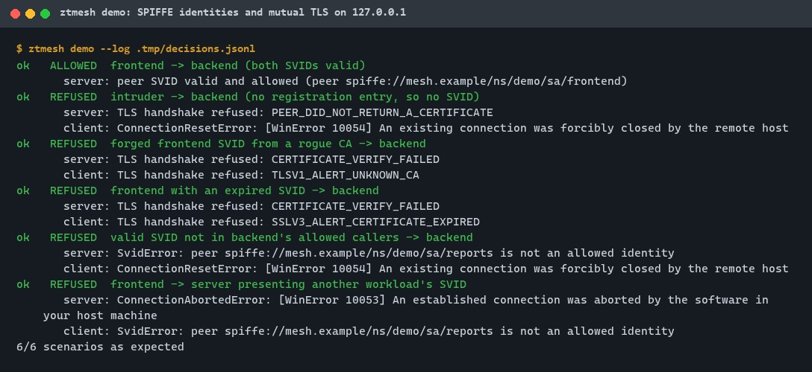
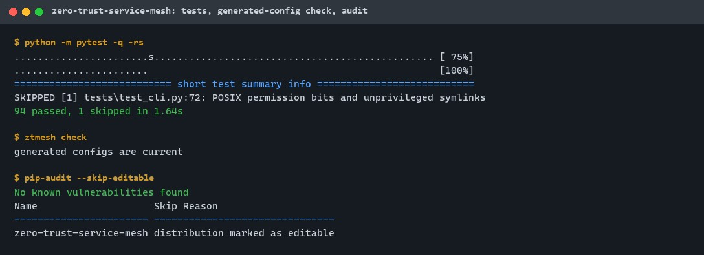
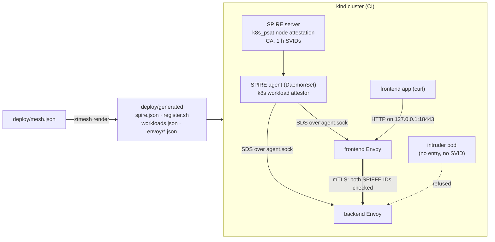
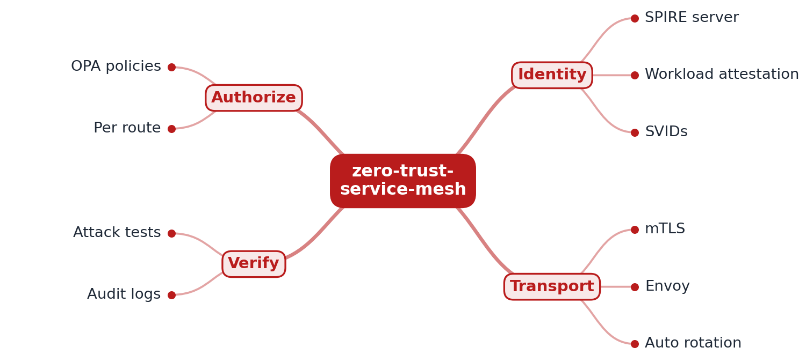

# zero-trust-service-mesh

[](https://github.com/EquinoxWN/zero-trust-service-mesh/actions/workflows/ci.yml)


> Workload identity for service-to-service calls: SPIRE attests each workload and issues a short-lived SPIFFE identity, and Envoy sidecars use it for mutual TLS, so every connection proves both identities. All configs are generated from one spec and checked locally and in a kind cluster.

Part of my **Cyber Security** list · Python · SPIRE · Envoy

## Proof it works

`ztmesh demo` attests workloads from the spec, issues X.509-SVIDs from a trust domain CA and runs
real TLS 1.3 handshakes on 127.0.0.1. The one allowed call proves both identities; five other
attempts are refused (no identity, forged CA, expired SVID, an identity the backend does not
list, and a server presenting the wrong identity):



95 tests pass locally (1 POSIX-only test is skipped on Windows), the generated SPIRE, Envoy and Kubernetes files match the spec, and the
dependency audit is clean:



The same claims against real SPIRE 1.15.5 and Envoy v1.39.5 run in a kind cluster in CI
(`kind-e2e` job). Its first run (run 43901407697) failed with HTTP 503 from the frontend
sidecar: Envoy's upstream TLS context allowed TLS 1.3 at minimum but Envoy defaults a client's
maximum to TLS 1.2, so no version was left to negotiate. Every generated TLS context now sets
both ends to TLS 1.3, and run 43904492171 passed all three jobs
([results](docs/results/m1.md#first-kind-run-2026-11-16)).

## Architecture

**What M1 runs:**



**Full roadmap (M1 to M3):**



## How it works

_Steps 1 and 2 are built and tested (M1); the rest is on the [roadmap](#roadmap)._

1. SPIRE attests each workload and issues short-lived SPIFFE identities (SVIDs).
2. Envoy sidecars use them for mutual TLS, so every connection proves both identities.
3. Certificates rotate automatically, typically every hour.
4. OPA decides per request which service may call which route.
5. A pod without an identity is refused, and a compromised service cannot reach anything its policy does not allow.
6. Every decision is logged for audit.

In M1 that means:

- **Spec.** `deploy/mesh.json` names the trust domain, the SVID lifetime (at most 1 hour), the
  workloads (namespace, service account, port), who may call whom, and an `unregistered`
  workload used as the negative test. Every cross reference is validated.
- **Identity.** Each registered workload gets a registration entry selecting `k8s:ns` and
  `k8s:sa`, parented to the node alias of the k8s_psat-attested agents; its ID is
  `spiffe://mesh.example/ns/<namespace>/sa/<service account>`.
- **Transport.** Envoy fetches its SVID and the trust bundle from the SPIRE agent over SDS. The
  backend's listener requires a client certificate and accepts only the IDs in `allowed_callers`;
  the frontend's cluster accepts only the backend's ID. TLS 1.3 only (minimum and maximum both set). Apps talk plain HTTP
  to their own sidecar on 127.0.0.1 only.
- **Local model.** The same rules in Python: SPIRE's selector matching, a CA that issues SVIDs,
  X509-SVID verification (RFC 5280 path validation through `cryptography` plus the SPIFFE rules)
  and real handshakes with Python's `ssl`.

## Who it helps

- **Who:** Platform and security engineers who want to add workload identity and mutual TLS
  between services, and engineers preparing for "design service-to-service authentication".
- **The problem:** On a flat cluster network, any pod that can reach a service can call it;
  IP addresses and labels are not proof of who is calling.
- **How to use it:** Describe your workloads in `deploy/mesh.json`, run `ztmesh render` to get
  SPIRE, registration and Envoy configs, run `ztmesh demo` to see which connections are allowed
  and why the others are refused, and apply the files to a cluster as `deploy/kind/e2e.sh` does.

## Tech stack

| Area | In M1 | Planned |
|---|---|---|
| Identity | SPIRE 1.15.5 (k8s_psat node and k8s workload attestation), SPIFFE X.509-SVIDs, 1 h TTL | rotation proof (M2), SPIFFE CSI driver and Controller Manager (ADR 0003) |
| Transport | Envoy v1.39.5 sidecars, SDS from the SPIRE agent, TLS 1.3 mutual TLS with SPIFFE ID matching | - |
| Authorization | peer SPIFFE ID allow lists per listener | OPA (Rego) per route via Envoy ext_authz (M2) |
| Local model and tests | Python 3.11+, `cryptography`, `ssl`, pytest, ruff, mypy `--strict`, pip-audit | - |
| CI | GitHub Actions, `envoy --mode validate`, kind v0.33.0 (Kubernetes v1.37.0) | audit log of every decision (M3) |

Language: **Python** (3.11+). Code in [`src/zero_trust_service_mesh/`](src/zero_trust_service_mesh).

## Run it

**Prerequisites:** Python 3.11+. Docker and kind are needed only for the cluster test, which CI runs.

```bash
python -m venv .venv && source .venv/bin/activate   # Windows: .venv\Scripts\activate
make setup     # install the package and dev tools
make lint      # ruff, ruff format, mypy --strict
make test      # 96 tests (95 run on Windows; 1 is POSIX-only)
make check     # generated configs match deploy/mesh.json
make demo      # one allowed and five refused mTLS connections; decision log in .tmp/
make audit     # pip-audit
make render    # after editing deploy/mesh.json
```

On a Linux machine with Docker (what the `kind-e2e` CI job does):

```bash
kind create cluster --name zt-demo
bash deploy/kind/e2e.sh   # applies SPIRE, registers entries, deploys workloads, checks mTLS
```

The CLI reads no environment variables; every option is a flag (`ztmesh --help`).

## Tests and results

Full numbers and commands: [docs/results/m1.md](docs/results/m1.md). The 10-rule quality check
and the mutation table are in [docs/quality/2026-11-01.md](docs/quality/2026-11-01.md).

| File | Tests | What it proves |
|---|---|---|
| `test_spiffe.py` | 27 | SPIFFE IDs parsed per the spec; 16 malformed IDs rejected; DNS-1123 labels |
| `test_mesh.py` | 23 | The committed spec is valid; 19 broken or inconsistent specs rejected; bad JSON and oversized files |
| `test_attestation.py` | 8 | SPIRE matching: only a registered namespace + service account under the right agent gets an ID |
| `test_ca_verify.py` | 9 | 1 h SVIDs that never outlive the CA; expired, not-yet-valid, rogue-CA, foreign and malformed SVIDs rejected |
| `test_mtls.py` | 5 | Real TLS 1.3 on 127.0.0.1: both IDs proven; no client certificate refused; all six demo scenarios as expected |
| `test_render.py` | 16 | Client certificates required, TLS 1.3 at both ends of every TLS context, Envoy admin only on a Unix socket the app container cannot see, exact SPIFFE ID matchers, SDS on the agent socket, images by digest, limits, no tokens, least-privilege RBAC, committed files current |
| `test_cli.py` | 7 | Exit codes, decision log (12 JSON records, UTC), atomic writes with unpredictable temp names (no planted file or symlink is reused) and the requested mode |
| `test_smoke.py` | 1 | Package version |

| Check | Result |
|---|---|
| Tests (`make test`) | **95 passed**, 0 failed, 1 skipped on Windows (POSIX symlink and mode test, runs in CI) |
| Demo | 6 of 6 scenarios as expected: 1 allowed, 5 refused |
| Mutation testing | 15 of 15 hand mutations killed |
| Lint / types / audit | ruff and mypy `--strict` clean; `pip-audit`: no known vulnerabilities |
| CI (run 43904492171) | `build`, `envoy --mode validate` (3 bootstraps valid) and kind e2e (all 6 cluster checks) passed; the earlier run 43901407697 failed on the TLS version range |

## Roadmap

**M1** (≈8 h)
- [x] Write `docs/rfc/0001-design.md`: problem, goals, non-goals, chosen design
- [x] SPIRE attests each workload and issues short-lived SPIFFE identities (SVIDs).
- [x] Envoy sidecars use them for mutual TLS, so every connection proves both identities.

**M2** (≈8 h)
- [ ] Certificates rotate automatically, typically every hour.
- [ ] OPA decides per request which service may call which route.

**M3** (≈9 h)
- [ ] A pod without an identity is refused, and a compromised service cannot reach anything its policy does not allow.
- [ ] Every decision is logged for audit.
- [ ] Publish the proof below with real numbers

## Proof

What this repo must show before it counts as done:

- A lateral-movement attempt that fails, with the denial visible in logs.

| Result | Value |
|---|---|
| M3 proof above | Not measured yet (M3). Current M1 numbers: see [Tests and results](#tests-and-results). |

## Why it matters

- **Interview angle:** 'Design service-to-service authentication'.
- **Upstream I'm contributing to:** SPIFFE / SPIRE.

## Design docs

- [RFC 0001: design](docs/rfc/0001-design.md)
- [ADR 0001: record architecture decisions](docs/adr/0001-record-architecture-decisions.md)
- [ADR 0002: a local reference model plus a kind cluster](docs/adr/0002-local-reference-model-plus-kind.md)
- [ADR 0003: hostPath socket before the SPIFFE CSI driver](docs/adr/0003-hostpath-socket-before-csi-driver.md)
- [M1 results](docs/results/m1.md)

## Scope

This is a learning and portfolio system, not a hosted production service. The local demo runs
only on 127.0.0.1 with throwaway keys that live in a temporary directory for the length of a run;
the cluster test runs only in a disposable kind cluster in CI. No real secrets are used anywhere.

## Security and contributing

- Every GitHub Action is pinned to a commit SHA and every container image by digest; workflows
  run read-only, without persisted credentials.
- Containers run with limits, a read-only root filesystem and no privilege escalation; workload
  pods get no service account token; the Envoy admin API listens only on a Unix socket in a
  volume the app container does not mount; the SPIRE server runs as uid 1000 and may update only the
  `spire-bundle` ConfigMap.
- Dependabot update pull requests are paused (`open-pull-requests-limit: 0`) so the repository
  keeps a single `main` branch; dependencies are updated by hand and checked by the CI audit.
- Report vulnerabilities privately: see [SECURITY.md](SECURITY.md). To contribute, see [CONTRIBUTING.md](CONTRIBUTING.md).

## License

MIT, see [LICENSE](LICENSE).
